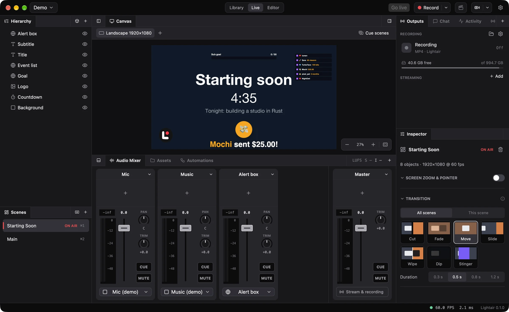
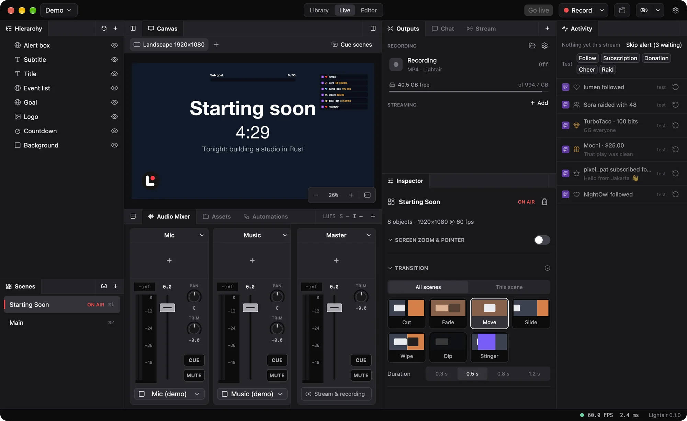

<p align="center">
  <picture>
    <source media="(prefers-color-scheme: dark)" srcset="site/assets/lockup-white.svg">
    
  </picture>
</p>

<p align="center">
  <b>A native live-production studio for streamers and creators.</b><br>
  The engine inside OBS, with a fast native interface, and everything you used to install a plugin for already built in.
</p>

<p align="center">
  <a href="https://github.com/MoonGoblinDev/lightair/releases/latest"></a>
  <a href="https://github.com/MoonGoblinDev/lightair/actions/workflows/ci.yml"></a>
  <a href="LICENSE"></a>
  <a href="https://moongoblindev.github.io/lightair/"></a>
</p>

<p align="center">
  
</p>

Lightair keeps **libobs**, the engine inside OBS Studio (capture, compositing, encoding, outputs and its plugins), and replaces everything you touch with an interface written in **Rust** on **GPUI**. Scenes, audio, chat, alerts, widgets, automations and multistreaming are designed together, share one undo history, and are controllable from anywhere.

## Download

| Platform | Get it | Needs |
|---|---|---|
| **macOS** | [Lightair-x.y.z.dmg](https://github.com/MoonGoblinDev/lightair/releases/latest) (signed and notarized) | macOS 14 or later, Apple silicon |
| **Windows** | [Lightair-x.y.z-windows-x64.zip](https://github.com/MoonGoblinDev/lightair/releases/latest) (portable) | Windows 10 22H2 or 11, x64 |

Lightair updates itself (Settings › About), and never installs an update while you're live. You don't need OBS installed.

## What's inside

**Build the show**
- Layers and scenes you edit right on the canvas: move, resize, rotate, crop, with snapping, multi-select and undo for everything.
- One show, several **formats**: landscape, vertical, square or 4:5 canvases with their own layouts, auto-reframed, edited side by side, with platform safe areas.
- Transitions: Cut, Fade, **Move** (layers glide to their new places), Slide, Wipe, Dip and Stinger, plus Studio mode with Take.
- Cameras, screens, windows and apps, images, video, text, countdowns and clocks, and full Chromium browser layers.
- **Effects** on a camera, face-aware (the Lightair Effect Stack): skin, makeup, segmentation and looks, on Core ML (macOS) and DirectML (Windows). Colour correction, keying and the rest on any layer, plus OBS filter plugins.
- Screen zoom and pointer for tutorials. Import your OBS scene collections.

**Sound right**
- A real mixer: channel strips with meters, faders, pan, trim, polarity, mono, cue and effects (Voice Clarity, EQ, compressor, limiter, VST3 plugins).
- Sends and mixes for headphones and a VOD track, per-app audio, multitrack recording, and EBU R128 loudness on the stream mix.

**Go live**
- Record to MP4, MKV or MOV with pause, chapter markers and split; clips from a replay buffer, with instant replay on air.
- Stream to many destinations at once over RTMP(S), SRT, RIST or WHIP; identical settings share one encoder. A Go Live review checks keys, encoder, upload, mic levels and disk first.
- Official sign-in for YouTube, Twitch, Kick and X: set the title and category from Lightair. Virtual camera.

**Your audience**
- One chat for Twitch, YouTube, Kick, TikTok, Bilibili, Douyu, Huya, Chzzk, SOOP, Niconico, TwitCasting and Showroom, with moderation.
- An Activity feed and tips through Streamlabs, StreamElements and Ko-fi, with nothing to host.
- Widgets served by Lightair itself: alert box, chat box, goal, event list, emote wall and combo, poll, prediction, wheel, leaderboard, subathon, credits, now playing, heart rate and more. StreamElements custom widgets import as they are.
- **Automations**: chat commands, timers and events that run chat replies, scene changes, sounds, speech, variables and lights (Philips Hue, Elgato Key Light, VTube Studio). Started from files, MIDI, game controllers or your voice. Streamer.bot actions import.

**Control it from anywhere**
- A remote API (JSON-RPC over WebSocket and HTTP), **obs-websocket v5 compatible** so OBS tools and decks work, and an MCP server so AI agents can run the show.
- A Stream Deck plugin, global shortcuts and a command palette (⌘K) for everything.

**An interface that gets out of the way**
- Every panel docks, tabs and rearranges: drop a tab at a sidebar's outer edge for a second sidebar, or open any panel in a window of its own.
- A console that tells you what needs attention (an unplugged mic, a stream that stopped) and fixes it.
- A Library of every recording and an Editor to cut them.

<p align="center">
  
</p>

## Build from source

You need Rust (stable), and on macOS Xcode with **OBS Studio 33.0.0** in `/Applications` (development builds use its `libobs.framework`; set `OBS_APP` for another place). Lightair's own libobs is OBS's official build, unmodified.

```bash
git clone https://github.com/MoonGoblinDev/lightair.git && cd lightair
git submodule update --init --depth 1
cargo xtask modules   # the Lightair Effect Stack module
cargo xtask bundle    # target/debug/Lightair.app
open target/debug/Lightair.app
```

On Windows, install OBS 33.0.0 and point `OBS_DIR` at it, then `cargo xtask dev` and `cargo run` (see [docs/plans/windows.md](docs/plans/windows.md)). `cargo xtask` lists everything else: `test`, `precommit`, `dist` (the signed release build) and more. Releases are cut by tagging: see [docs/releasing.md](docs/releasing.md).

## Learn more

- [Website](https://moongoblindev.github.io/lightair/)
- [Design docs](docs/README.md): what Lightair is and how each part works
- [Remote API](docs/remote-api.md) · [Official platform APIs](docs/official-apis.md) · [Brand](branding/README.md)
- [Build order and status](IMPLEMENTATION.md)

## License

GPL-3.0-or-later; see [LICENSE](LICENSE). Lightair is built on libobs (GPL-2.0-or-later) and GPUI and gpui-kit (Apache-2.0); see [docs/15](docs/15-platform-distribution-licensing.md#licensing).
